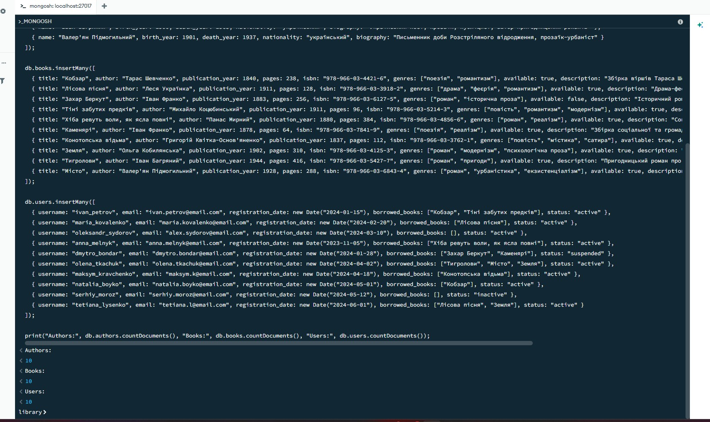
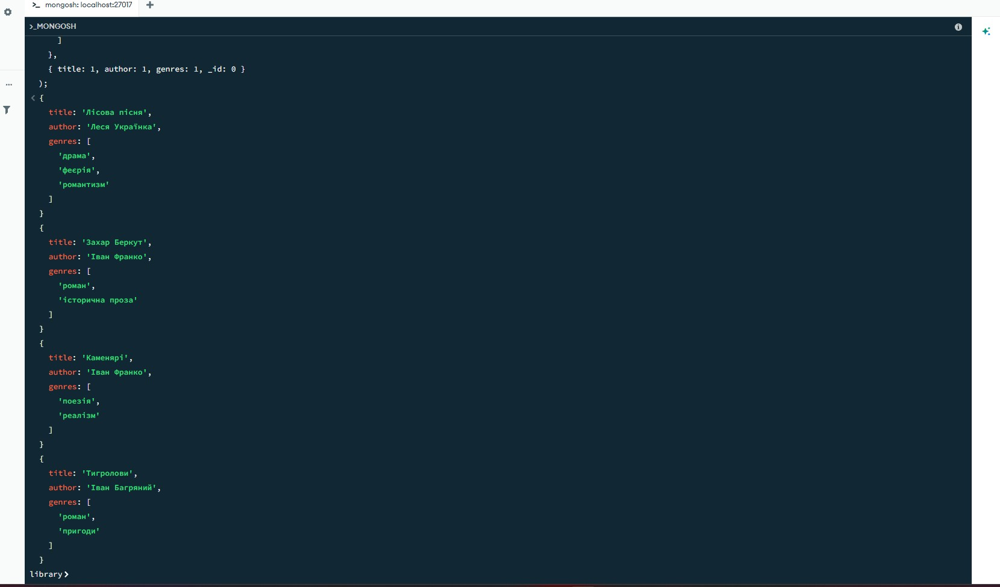
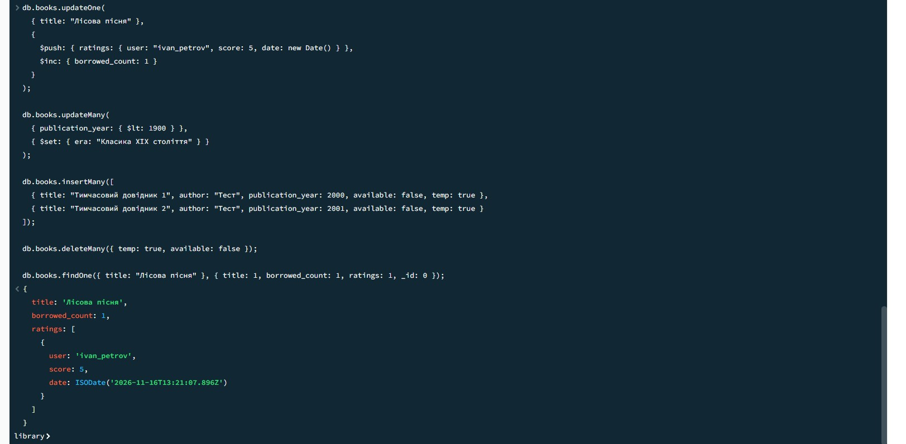
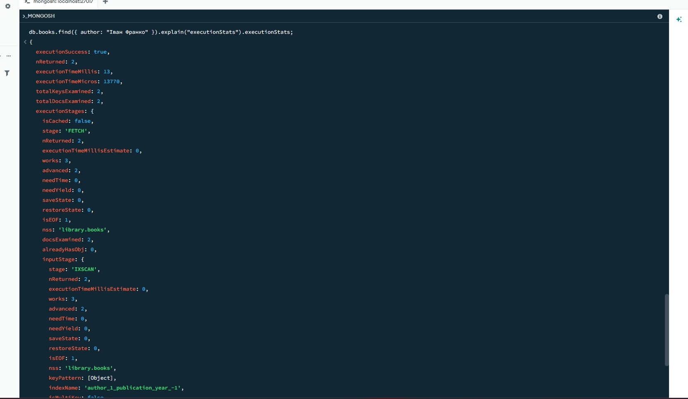
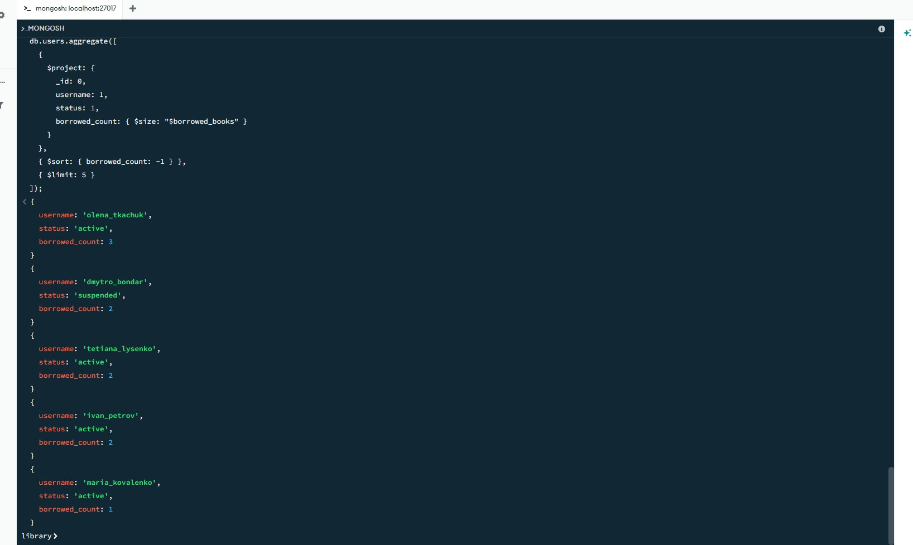
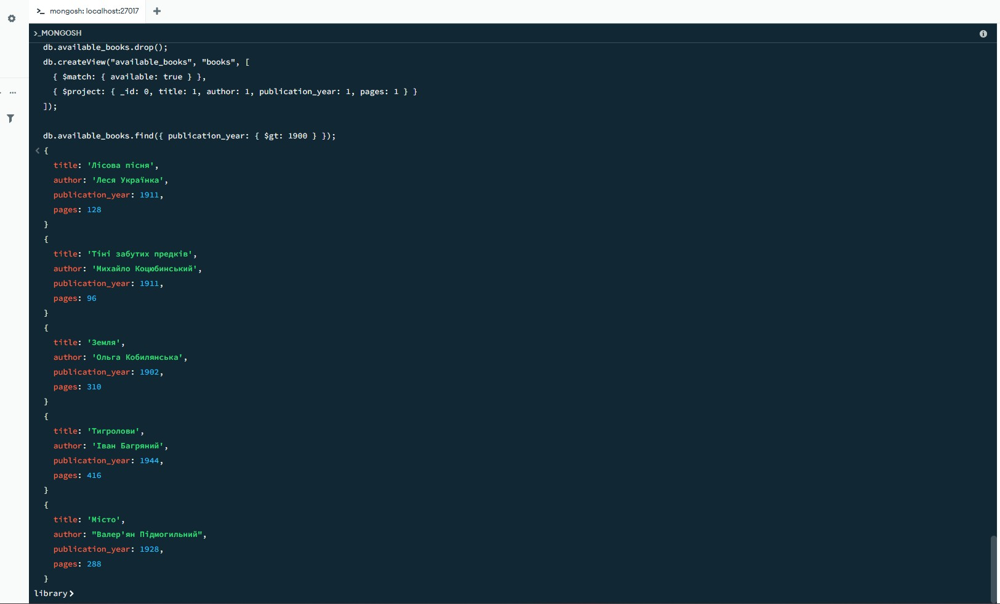
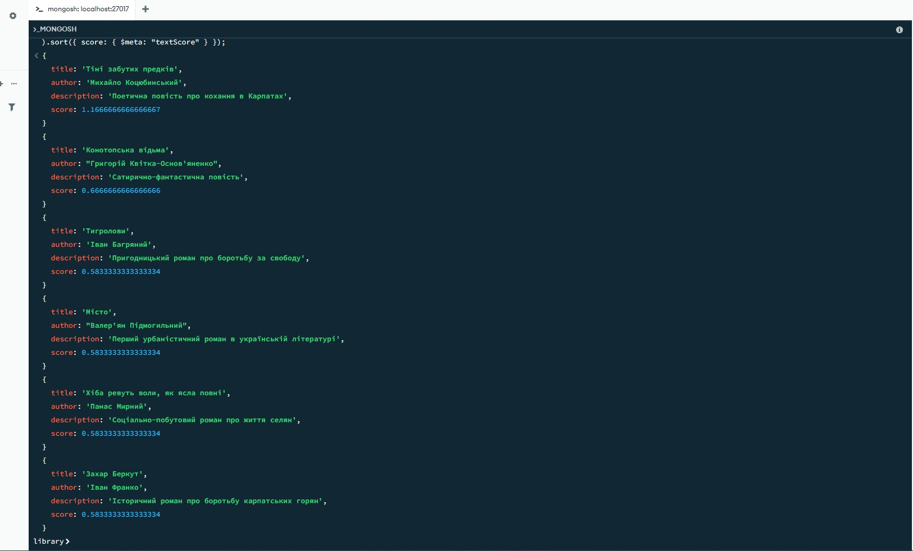

# Звіт з лабораторної роботи №6. Робота з СУБД MongoDB та реалізація операцій

## Загальна інформація

- **Здобувач освіти:** Зрелко Олександр Вадимович
- **Група:** ІПЗ - 32
- **Предметна область:** Електронна бібліотека (`library`: колекції `authors`, `books`, `users`)
- **Обраний рівень складності:** 2 (Достатній рівень — «добре»)

## Мета роботи

Освоїти принципи роботи з NoSQL документо-орієнтованою базою даних MongoDB, навчитися виконувати базові операції створення, читання, оновлення та видалення документів (CRUD), опанувати механізми складних запитів, агрегаційного конвеєра (Aggregation Pipeline), об'єднання колекцій (`$lookup`), індексування та повнотекстового пошуку.

## Виконання роботи (Рівень 1 та Рівень 2)

### Крок 1. Створення бази даних `library` та наповнення колекцій (по 10 документів)

Створено базу даних `library` і три колекції (`authors`, `books`, `users`), у кожну з яких додано по 10 структурованих документів із вкладеними масивами та об'єктами.

```javascript
// Перемикання на базу даних library
use library;

db.books.drop();
db.authors.drop();
db.users.drop();

// 1. Вставка 10 авторів у колекцію authors
db.authors.insertMany([
  { name: "Тарас Шевченко", birth_year: 1814, death_year: 1861, nationality: "український", biography: "Найвідоміший український поет, письменник, художник" },
  { name: "Леся Українка", birth_year: 1871, death_year: 1913, nationality: "український", biography: "Видатна українська письменниця, поетеса, драматург" },
  { name: "Іван Франко", birth_year: 1856, death_year: 1916, nationality: "український", biography: "Письменник, поет, публіцист, перекладач, науковець" },
  { name: "Михайло Коцюбинський", birth_year: 1864, death_year: 1913, nationality: "український", biography: "Український письменник-модерніст, майстер психологічної прози" },
  { name: "Панас Мирний", birth_year: 1849, death_year: 1920, nationality: "український", biography: "Український письменник-реаліст, драматург" },
  { name: "Григорій Квітка-Основ'яненко", birth_year: 1778, death_year: 1843, nationality: "український", biography: "Письменник, засновник новітньої української прози" },
  { name: "Василь Стефаник", birth_year: 1871, death_year: 1936, nationality: "український", biography: "Письменник-новеліст, майстер експресіоністичної новели" },
  { name: "Ольга Кобилянська", birth_year: 1863, death_year: 1942, nationality: "український", biography: "Українська письменниця-модерністка, учасниця феміністичного руху" },
  { name: "Іван Багряний", birth_year: 1906, death_year: 1963, nationality: "український", biography: "Український поет, прозаїк, публіцист, автор пригодницьких романів" },
  { name: "Валер'ян Підмогильний", birth_year: 1901, death_year: 1937, nationality: "український", biography: "Письменник доби Розстріляного відродження, прозаїк-урбаніст" }
]);

// 2. Вставка 10 книг у колекцію books
db.books.insertMany([
  { title: "Кобзар", author: "Тарас Шевченко", publication_year: 1840, pages: 238, isbn: "978-966-03-4421-6", genres: ["поезія", "романтизм"], available: true, description: "Збірка віршів Тараса Шевченка" },
  { title: "Лісова пісня", author: "Леся Українка", publication_year: 1911, pages: 128, isbn: "978-966-03-3918-2", genres: ["драма", "феєрія", "романтизм"], available: true, description: "Драма-феєрія за мотивами українського фольклору" },
  { title: "Захар Беркут", author: "Іван Франко", publication_year: 1883, pages: 256, isbn: "978-966-03-6127-5", genres: ["роман", "історична проза"], available: false, description: "Історичний роман про боротьбу карпатських горян" },
  { title: "Тіні забутих предків", author: "Михайло Коцюбинський", publication_year: 1911, pages: 96, isbn: "978-966-03-5214-3", genres: ["повість", "романтизм", "модернізм"], available: true, description: "Поетична повість про кохання в Карпатах" },
  { title: "Хіба ревуть воли, як ясла повні", author: "Панас Мирний", publication_year: 1880, pages: 384, isbn: "978-966-03-4856-6", genres: ["роман", "реалізм"], available: true, description: "Соціально-побутовий роман про життя селян" },
  { title: "Каменярі", author: "Іван Франко", publication_year: 1878, pages: 64, isbn: "978-966-03-7841-9", genres: ["поезія", "реалізм"], available: true, description: "Збірка соціальної та громадянської поезії" },
  { title: "Конотопська відьма", author: "Григорій Квітка-Основ'яненко", publication_year: 1837, pages: 112, isbn: "978-966-03-3762-1", genres: ["повість", "містика", "сатира"], available: true, description: "Сатирично-фантастична повість" },
  { title: "Земля", author: "Ольга Кобилянська", publication_year: 1902, pages: 310, isbn: "978-966-03-4125-3", genres: ["роман", "модернізм", "психологічна проза"], available: true, description: "Психологічна драма про владу землі над людиною" },
  { title: "Тигролови", author: "Іван Багряний", publication_year: 1944, pages: 416, isbn: "978-966-03-5427-7", genres: ["роман", "пригоди"], available: true, description: "Пригодницький роман про боротьбу за свободу" },
  { title: "Місто", author: "Валер'ян Підмогильний", publication_year: 1928, pages: 288, isbn: "978-966-03-6843-4", genres: ["роман", "урбаністика", "екзистенціалізм"], available: true, description: "Перший урбаністичний роман в українській літературі" }
]);

// 3. Вставка 10 користувачів у колекцію users
db.users.insertMany([
  { username: "ivan_petrov", email: "ivan.petrov@email.com", registration_date: new Date("2024-01-15"), borrowed_books: ["Кобзар", "Тіні забутих предків"], status: "active" },
  { username: "maria_kovalenko", email: "maria.kovalenko@email.com", registration_date: new Date("2024-02-20"), borrowed_books: ["Лісова пісня"], status: "active" },
  { username: "oleksandr_sydorov", email: "alex.sydorov@email.com", registration_date: new Date("2024-03-10"), borrowed_books: [], status: "active" },
  { username: "anna_melnyk", email: "anna.melnyk@email.com", registration_date: new Date("2023-11-05"), borrowed_books: ["Хіба ревуть воли, як ясла повні"], status: "active" },
  { username: "dmytro_bondar", email: "dmytro.bondar@email.com", registration_date: new Date("2024-01-28"), borrowed_books: ["Захар Беркут", "Каменярі"], status: "suspended" },
  { username: "olena_tkachuk", email: "olena.tkachuk@email.com", registration_date: new Date("2024-04-02"), borrowed_books: ["Тигролови", "Місто", "Земля"], status: "active" },
  { username: "maksym_kravchenko", email: "maksym.k@email.com", registration_date: new Date("2024-04-18"), borrowed_books: ["Конотопська відьма"], status: "active" },
  { username: "natalia_boyko", email: "natalia.boyko@email.com", registration_date: new Date("2024-05-01"), borrowed_books: ["Кобзар"], status: "active" },
  { username: "serhiy_moroz", email: "serhiy.moroz@email.com", registration_date: new Date("2024-05-12"), borrowed_books: [], status: "inactive" },
  { username: "tetiana_lysenko", email: "tetiana.l@email.com", registration_date: new Date("2024-06-01"), borrowed_books: ["Лісова пісня", "Земля"], status: "active" }
]);

// Перевірка кількості документів у кожній колекції
print("Authors:", db.authors.countDocuments(), "Books:", db.books.countDocuments(), "Users:", db.users.countDocuments());
```



### Крок 2. Пошук документів та складні фільтри (`$and`, `$or`, `$in`, `$regex`)

Виконано вибірку документів із використанням операторів порівняння (`$gt`, `$gte`), входження до списку (`$in`), логічних конструкцій (`$and`, `$or`), регулярних виразів (`$regex`), проєкції полів та сортування.

```javascript
// 1. Пошук доступних книг обсягом понад 200 сторінок, виданих після 1880 року ($and + $gt)
db.books.find(
  {
    $and: [
      { available: true },
      { pages: { $gt: 200 } },
      { publication_year: { $gte: 1880 } }
    ]
  },
  { title: 1, author: 1, pages: 1, publication_year: 1, _id: 0 }
).sort({ pages: -1 });

// 2. Пошук за входженням у масив жанрів ($in) та логічним АБО ($or)
db.books.find(
  {
    $or: [
      { genres: { $in: ["феєрія", "пригоди"] } },
      { author: { $regex: "^Іван", $options: "i" } }
    ]
  },
  { title: 1, author: 1, genres: 1, _id: 0 }
);
```



### Крок 3. Операції оновлення (`updateOne`, `updateMany`) та видалення (`deleteOne`, `deleteMany`)

Продемонстровано модифікацію окремих полів (`$set`), додавання елементів у вкладений масив (`$push`), інкрементування лічильника (`$inc`), а також безпечне додавання та видалення тимчасових документів за умовою.

```javascript
// 1. Додавання відгуку до масиву ratings та збільшення лічильника видач
db.books.updateOne(
  { title: "Лісова пісня" },
  {
    $push: { ratings: { user: "ivan_petrov", score: 5, date: new Date() } },
    $inc: { borrowed_count: 1 }
  }
);

// 2. Масове оновлення категорії для класичних творів XIX століття
db.books.updateMany(
  { publication_year: { $lt: 1900 } },
  { $set: { era: "Класика XIX століття" } }
);

// 3. Додавання та видалення тимчасових документів
db.books.insertMany([
  { title: "Тимчасовий довідник 1", author: "Тест", publication_year: 2000, available: false, temp: true },
  { title: "Тимчасовий довідник 2", author: "Тест", publication_year: 2001, available: false, temp: true }
]);

db.books.deleteMany({ temp: true, available: false });

// Перевірка оновленої книги "Лісова пісня"
db.books.findOne({ title: "Лісова пісня" }, { title: 1, borrowed_count: 1, ratings: 1, _id: 0 });
```



### Крок 4. Створення індексів та порівняння продуктивності (`explain("executionStats")`)

Створено три індекси (простий за назвою, складений `compound` за автором і роком видання та унікальний за `isbn`). Проведено порівняння плану виконання до та після індексації: після створення індексу тип сканування змінився з `COLLSCAN` (повний перебір колекції) на `IXSCAN` (читання лише потрібних ключів з B-tree індексу).

```javascript
// 1. Створення простого, складеного (compound) та унікального індексів
db.books.createIndex({ title: 1 });
db.books.createIndex({ author: 1, publication_year: -1 });
db.books.createIndex({ isbn: 1 }, { unique: true });

// 2. Перевірка створених індексів
db.books.getIndexes();

// 3. Аналіз плану виконання з використанням індексу (IXSCAN)
db.books.find({ author: "Іван Франко" }).explain("executionStats").executionStats;
```

**Порівняння ефективності запиту пошуку за автором:**

| Показник `executionStats` | Без індексу (`COLLSCAN`) | З індексом (`IXSCAN`) |
| :--- | :--- | :--- |
| Етап виконання (`stage`) | `COLLSCAN` (повний перебір) | `IXSCAN` (`author_1_publication_year_-1`) |
| Перевірено документів (`totalDocsExamined`) | `10` (уся колекція) | `2` (лише релевантні документи) |
| Перевірено ключів індексу (`totalKeysExamined`) | `0` | `2` |



### Крок 5. Агрегаційні запити з використанням Pipeline (Рівень 2)

Реалізовано конвеєри агрегації з розгортанням масивів (`$unwind`), групуванням за категоріями (`$group`), обчисленням середньої кількості сторінок (`$avg`) та рейтингом найактивніших читачів.

```javascript
// 1. Підрахунок кількості книг та середнього обсягу сторінок за кожним жанром
db.books.aggregate([
  { $unwind: "$genres" },
  {
    $group: {
      _id: "$genres",
      books_count: { $sum: 1 },
      avg_pages: { $round: [{ $avg: "$pages" }, 1] },
      titles: { $push: "$title" }
    }
  },
  { $sort: { books_count: -1, avg_pages: -1 } }
]);

// 2. Топ користувачів за кількістю взятих книг
db.users.aggregate([
  {
    $project: {
      _id: 0,
      username: 1,
      status: 1,
      borrowed_count: { $size: "$borrowed_books" }
    }
  },
  { $sort: { borrowed_count: -1 } },
  { $limit: 5 }
]);
```



### Крок 6. Об'єднання колекцій через `$lookup` та створення представлення `View` (Рівень 2)

Пов'язано документи колекції `books` з документами колекції `authors` через поле `author_id`, виконано об'єднання колекцій за допомогою етапу `$lookup` (аналог `LEFT JOIN` у SQL) та створено представлення `available_books`.

```javascript
// 1. Автоматичне проставлення посилань author_id у книгах
db.authors.find().forEach(function(a) {
  db.books.updateMany(
    { author: a.name },
    { $set: { author_id: a._id } }
  );
});

// 2. Об'єднання книг із детальною біографією авторів через $lookup
db.books.aggregate([
  {
    $lookup: {
      from: "authors",
      localField: "author_id",
      foreignField: "_id",
      as: "author_info"
    }
  },
  { $unwind: "$author_info" },
  {
    $project: {
      _id: 0,
      title: 1,
      publication_year: 1,
      "author_info.name": 1,
      "author_info.birth_year": 1,
      "author_info.biography": 1
    }
  },
  { $limit: 5 }
]);

// 3. Створення представлення (View) для доступних книг
db.available_books.drop();
db.createView("available_books", "books", [
  { $match: { available: true } },
  { $project: { _id: 0, title: 1, author: 1, publication_year: 1, pages: 1 } }
]);

db.available_books.find({ publication_year: { $gt: 1900 } });
```



### Крок 7. Повнотекстовий пошук із індексом `text` (Рівень 2)

Створено повнотекстовий індекс на полях `title` та `description` із параметром `default_language: "none"` для коректної токенізації українського тексту та виконано ранжований пошук за релевантністю (`$meta: "textScore"`).

```javascript
// 1. Створення текстового індексу на назву та опис книги
db.books.createIndex(
  { title: "text", description: "text" },
  { default_language: "none", name: "books_text_idx" }
);

// 2. Повнотекстовий пошук із сортуванням за оцінкою релевантності (textScore)
db.books.find(
  { $text: { $search: "роман повість кохання" } },
  { _id: 0, title: 1, author: 1, description: 1, score: { $meta: "textScore" } }
).sort({ score: { $meta: "textScore" } });
```



## Відповіді на контрольні запитання

1. **Основні відмінності між реляційними та документо-орієнтованими СУБД:**
   - Реляційні СУБД (PostgreSQL) зберігають дані у взаємопов'язаних таблицях із суворою нормалізованою схемою (3NF) і використовують `JOIN` та SQL. Вони оптимальні для фінансових і облікових систем із жорсткими вимогами ACID.
   - Документо-орієнтовані СУБД (MongoDB) зберігають самодостатні JSON/BSON-документи з гнучкою схемою, вкладеними об'єктами та масивами. Вони ефективні для каталогів товарів, контент-платформ, мікросервісів і швидкого горизонтального масштабування.
2. **Що таке BSON і чим він відрізняється від JSON:**
   - BSON (Binary JSON) — це бінарне представлення JSON-документів. На відміну від текстового JSON, BSON підтримує додаткові типи даних (`ObjectId`, `Date`/`ISODate`, `Int32`, `Int64`, `Decimal128`, `BinData`) і містить префікси довжини полів, що дозволяє MongoDB миттєво пропускати непотрібні поля під час сканування без повного парсингу рядка.
3. **Концепція денормалізації в NoSQL:**
   - Денормалізація полягає у вбудовуванні пов'язаних даних (наприклад, масиву жанрів чи відгуків) безпосередньо всередину документа книги. Перевага — миттєве читання всього об'єкта одним запитом без `JOIN`; недолік — необхідність оновлювати дубльовані дані в кількох місцях при їх зміні.
4. **Як працює агрегаційний pipeline у MongoDB:**
   - Це послідовність етапів (stages), де вихід одного етапу передається на вхід наступного: `$match` (фільтрація документів), `$unwind` (розгортання масивів у окремі документи), `$group` (групування й обчислення `$sum`, `$avg`, `$min`, `$max`), `$project` (вибір та обчислення полів), `$sort` (сортування), `$lookup` (приєднання іншої колекції).
5. **Індекси в MongoDB та їхні типи:**
   - Індекси зберігають впорядковані значення полів у B-tree структурі, усуваючи потребу в повному переборі колекції (`COLLSCAN`). Основні типи: однопольові (Single Field), складені (Compound), мультиключові (Multikey — для масивів), текстові (`text`), геопросторові (`2dsphere`), хешовані (`hashed`) та TTL-індекси (автовидалення за часом).
6. **Різниця між `updateOne`, `updateMany` та `replaceOne`:**
   - `updateOne` змінює лише вказані поля (через `$set`, `$inc`, `$push`) у першому знайденому документі.
   - `updateMany` застосовує модифікатори до всіх документів, що задовольняють умову фільтра.
   - `replaceOne` повністю перезаписує весь документ новим об'єктом (зберігаючи лише `_id`), видаляючи всі старі поля, яких немає в новому документі.
7. **Валідація схеми через JSON Schema:**
   - Задається під час `db.createCollection()` або через `collMod` у параметрі `validator: { $jsonSchema: { ... } }`. Дозволяє контролювати обов'язкові поля (`required`), типи даних (`bsonType`), числові межі (`minimum`, `maximum`) та регулярні вирази (`pattern`).
8. **Зв'язки між документами (Embedding vs Referencing):**
   - **Вбудовування (Embedding):** збереження вкладених об'єктів/масивів усередині документа — найкраще для зв'язків «один-до-одного» та «один-до-небагатьох», які завжди читаються разом.
   - **Посилання (Referencing):** збереження `ObjectId` іншого документа (наприклад, `author_id`) з подальшим об'єднанням через `$lookup` — використовується для зв'язків «багато-до-багатьох» або коли вкладені дані необмежено ростуть.
9. **Текстовий індекс (`text`):**
   - Індексує слова з рядкових полів документа (допускається один текстовий індекс на колекцію, але він може охоплювати кілька полів). Пошук виконується оператором `{ $text: { $search: "..." } }`, а релевантність обчислюється через `{ $meta: "textScore" }`.
10. **Масштабування MongoDB (Реплікація та Sharding):**
    - **Реплікація (Replica Set):** синхронізація однакових копій даних між основним вузлом (Primary) і вторинними вузлами (Secondary) для відмовостійкості та розподілу читання.
    - **Шардинг (Sharding):** горизонтальне розділення великої колекції на частини (shards) за ключем шардингу (Shard Key) між різними серверами для масштабування запису та обсягу пам'яті.

## Висновки

Під час виконання лабораторної роботи №6 було опановано роботу з документо-орієнтованою СУБД MongoDB на прикладі інформаційної системи електронної бібліотеки `library`:
1. Створено колекції `authors`, `books` та `users` і наповнено їх по 10 документами зі складною структурою (вкладені об'єкти, масиви жанрів, списки взятих книг та оцінок).
2. Виконано повний цикл CRUD-операцій із використанням логічних операторів (`$and`, `$or`), операторів порівняння (`$gt`, `$gte`, `$in`), регулярних виразів (`$regex`) та модифікаторів масивів (`$push`, `$inc`).
3. Побудовано прості, складені, унікальні й текстові індекси; за допомогою `.explain("executionStats")` підтверджено перехід від повного сканування `COLLSCAN` до індексного пошуку `IXSCAN`.
4. Реалізовано багатоетапні агрегаційні конвеєри (`$unwind`, `$group`, `$project`, `$sort`), міжколекційне об'єднання через `$lookup`, представлення `available_books` та повнотекстовий пошук за релевантністю.

- **Самооцінка:** 4 (добре)
- **Обґрунтування:** У повному обсязі виконано всі вимоги Рівня 1 та Рівня 2: створено та заповнено 3 колекції по 10 документів, реалізовано CRUD-запити, індексацію з аналізом `executionStats`, агрегаційні конвеєри, `$lookup`, представлення та повнотекстовий пошук.

